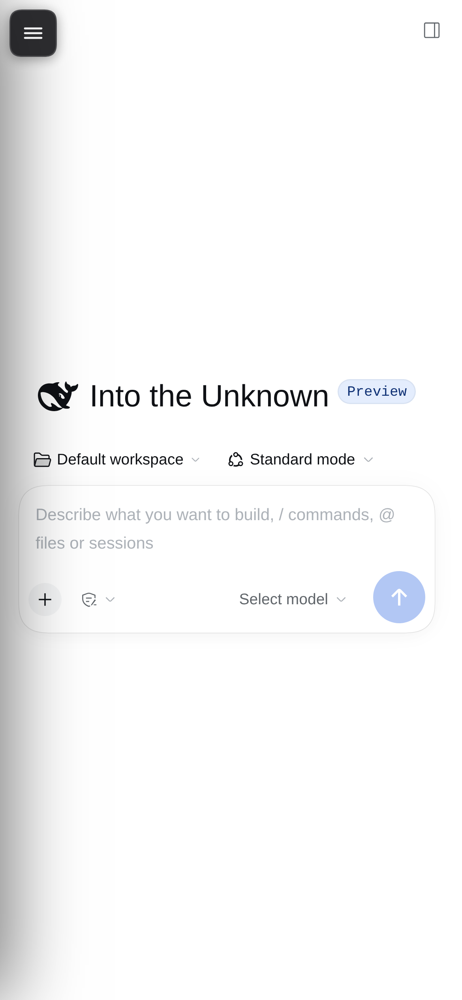
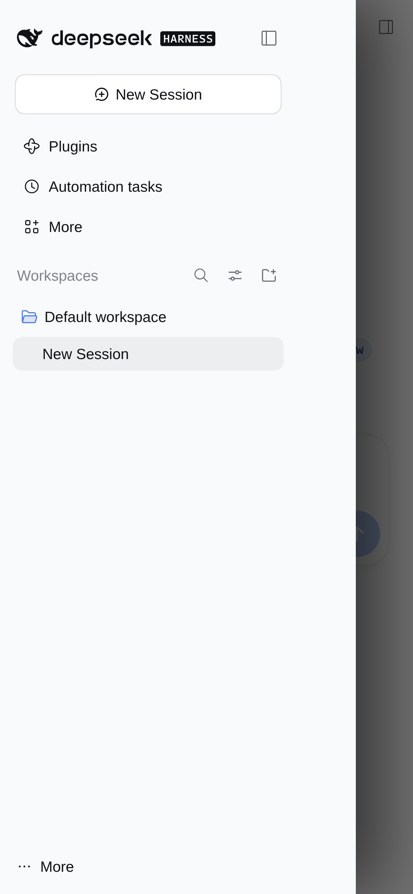
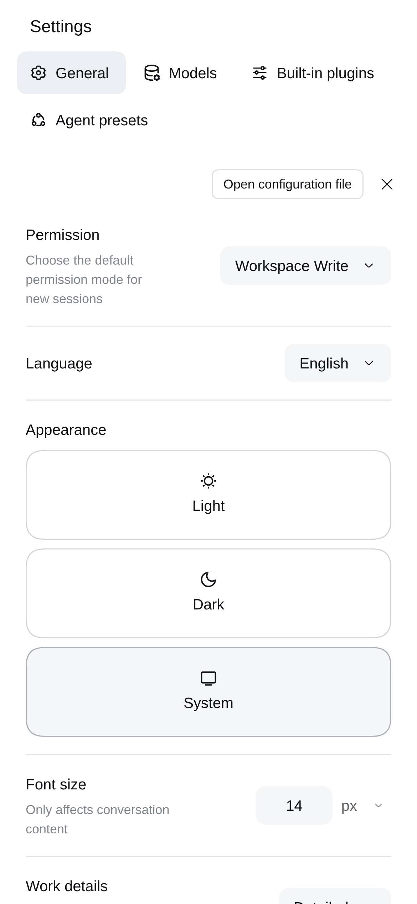

# dsh-mobile-ui

A phone layout for the [DeepSeek Harness](https://github.com/deepseek-ai/deepseek-harness) web GUI.

DSH's web UI is a three-column desktop layout. On a phone the left rail eats
width, opening the sidebar squeezes the conversation to a sliver, the right
panel can open completely off-screen, the on-screen keyboard covers the
composer, and the editor's 14px font triggers mobile zoom. This package is a
single DSH **client plugin** that fixes all of that without touching the app,
the server, or your sessions.

| Phone layout | Drawer navigation | Settings sheet |
|---|---|---|
|  |  |  |

## What changes (below 900px)

| Desktop behaviour on a phone | With this plugin |
|---|---|
| 56px rail + a 280px sidebar that squeezes the chat to ~110px | rail leaves the grid; sidebar becomes an off-canvas drawer over a full-width conversation |
| right panel opens at `x=viewport`, width 0 — invisible | right panel becomes a full-screen sheet |
| no navigation without the rail | 40px menu button, edge-swipe right to open, swipe left / tap the scrim to close |
| picking a session leaves the drawer covering it | drawer closes itself when the conversation changes |
| keyboard covers the composer | layout follows `visualViewport` height, so the composer stays visible |
| Enter inserts a newline on mobile keyboards | capture-phase Enter clicks the real Send button; Shift+Enter stays a newline; IME composition is skipped |
| 14px editor, 34px send button, 28px icons | 16px editor, 44px send button, larger touch targets, safe-area insets |
| Settings is a 342px two-column squeeze | full-width settings sheet with wrapping tabs |
| pull-to-refresh and scroll chaining | `overscroll-behavior` contained on the page and the conversation scroller |

Wider windows (>= 900px) are untouched; the plugin is inert on the desktop.

## Requirements

- DeepSeek Harness with the web app (`dsh web`), version **0.2.1-rc.5** built/tested.
- A profile that includes the web app. The default profile is `web`.
- Nothing else at runtime. No server code, no extra npm dependencies, no build step.

## Install

### A. With an AI agent (recommended)

Copy the prompt from [INSTALL_AGENT.md](INSTALL_AGENT.md) into your coding
agent, replacing `<REPO>` with this repository (or a local checkout path). The
prompt tells it to install the bundle, verify the boot graph, and run the phone
check without sending any real messages.

### B. DSH plugin CLI

```bash
# from a git repository
dsh plugin --profile web add github:OWNER/dsh-mobile-ui
# or from a local checkout (pnpm accepts a path or file: spec)
dsh plugin --profile web add /path/to/dsh-mobile-ui
```

The plugin manager installs the package, adds it to your profile's
`dsh.profile.bundles`, and enables it. If your DSH host does not hot-reload new
bundles, restart `dsh web`.

### C. Manual profile edit (older DSH builds)

In `$DSH_HOME/profiles/web/package.json`:

```json
{
  "dependencies": {
    "dsh-mobile-ui": "link:/path/to/dsh-mobile-ui"
  },
  "dsh": {
    "profile": {
      "bundles": ["…", "dsh-mobile-ui"]
    }
  }
}
```

Then install the link and restart the host:

```bash
cd "$DSH_HOME/profiles/web" && pnpm install --offline
dsh web
```

The package's own `cordis.patch.yml` inserts the plugin entry; you do not edit
the profile patch by hand.

### After installing

Open the web UI on the phone (or resize a desktop window below 900px). If the
page was already open before the install, reload it once. Your existing sessions
are untouched.

## Verify it

`test_phone.py` drives a headless Chromium at 390x844 with an Android user agent
and checks the phone layout, drawer, swipe, right panel, keyboard resize, Enter
behaviour, settings sheet and desktop inertness. It aborts every
`session/prompt` request, so it cannot send a message or start a turn.

```bash
# the web UI URL may carry a launch token; keep it out of logs
python3 -m pip install playwright   # once
python3 test_phone.py                # reads ~/.dsh/web_url when DSH_WEB_URL is unset
DSH_WEB_URL=http://127.0.0.1:3080/?token=… python3 test_phone.py
```

On Linux, run it under a virtual display so no window appears:

```bash
xvfb-run -a python3 test_phone.py
```

Exit code 0 means all checks passed. Screenshots land in
`/tmp/dsh-mobile-ui-out/` (override with `DSH_MOBILE_OUT`).

A clean-install check was run from a fresh `DSH_HOME`: `dsh plugin --profile web
add <path to this repo>` added the dependency and appended `dsh-mobile-ui` to
`dsh.profile.bundles`; the plugin loaded on the next host start and the phone
layout was active at 390x844 (`window.__dshMobileUI.version = 0.1.0`). The
screenshots above come from that clean profile, so they contain no real
sessions.

## How it works

- `index.js` is the host half: a no-op Cordis plugin.
- `client.js` is the browser half, loaded through the normal
  `window.__ModuleLoader__` boot graph. It injects one `<style>` element and a
  small amount of DOM and listens to the app's own state (`data-conversation-session`,
  `data-sidebar-right-open`, the sidebar's collapsed class).
- The phone layout is CSS over the app's computed grid plus fixed-position
  sheets; the JS only moves focus, tracks the keyboard viewport, handles swipes
  and Enter, and adds a backdrop.
- `cordis.patch.yml` inserts the plugin; the package declares `dsh.bundle.patch`
  and `dsh.client`, so the plugin manager can add, disable and remove it like
  any other bundle.

## Compatibility

Built and verified against **DSH 0.2.1-rc.5**. The app's DOM uses build-hashed
CSS-module class names; the plugin matches readable suffixes
(`_sidebarCol`, `_centerCol`, `_rightbarCol`, `_frame`, …) and the settings
dialog's `VOzbGW_*` tokens. A future DSH release may rename them.

The plugin checks for the expected layout shortly after mount and logs one
warning if it cannot find it:

```
[dsh-mobile-ui] expected DSH layout not found (built against DSH 0.2.1-rc.5)…
```

Recent DSH versions, a supported profile layout (web app + plugin manager), and
`test_phone.py` passing are the compatibility test.

## Known limits

- **Real soft-keyboard Enter is the one path CI cannot replay.** The handler
  covers both a real Enter keydown and a `beforeinput` line break; if your phone
  keyboard still inserts a newline, open an issue with the phone model and
  keyboard app.
- **No multiline gesture on touch.** Shift+Enter is the newline and a phone
  keyboard has no Shift. Pasting a multiline block still works.
- **Enter while a turn is running** is not intercepted (the primary button is
  Stop, not Send), so it keeps the app's default behaviour.
- **English UI strings.** Menu and send lookups use the English aria-labels
  (`Open right sidebar`, `Send message`, `Account menu`); a non-English UI
  breaks those lookups, not the layout.
- Screenshots show a clean profile; the plugin never reads or uploads session
  data.

## License

MIT. See [LICENSE](LICENSE).
